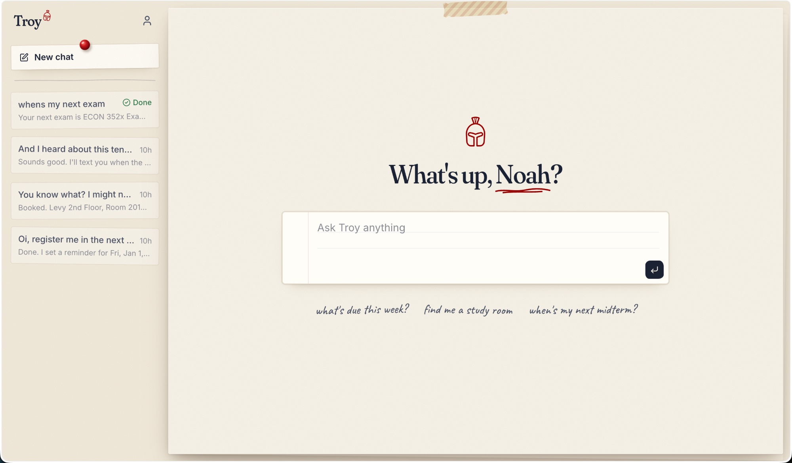

<p align="center">
  
</p>

Troy is a personal assistant for USC students. Text it on iMessage or chat on the web, and it works across your USC accounts (Brightspace, Web Registration, Leavey Library rooms, mobile ordering and Handshake) to answer questions and get things done.



## What you can ask

- "What's due this week?"
- "When's my next midterm, and what does it cover?"
- "Find me a study room in Leavey tonight for 4 people."
- "Order me an iced latte for pickup at 10."
- "Text me if a seat opens up in PHED 140a."
- "Add the 6pm section of BUAD 304 to my schedule."
- "Which career fairs are coming up for CS?"
- "Remind me to submit my ECON problem set Thursday at 8."

Troy also texts you on its own: new grades as they post, reminders you set and anything a monitor you asked for turns up. Before it books, orders or registers, it shows you what it's about to do and waits for a yes.

## How it works

Every student gets their own agent. It writes and runs Python in a sandboxed Docker container, uses on-demand Markdown skills, and can hand sub-tasks to fresh agents. It reaches USC through [usc-cli](https://github.com/nsigel/usc-cli), a command-line client for USC's systems that prints JSON, signed in as that student.

`troy serve` is the one server. iMessage (through Sendblue), the web app and `troy chat` are all ways in.

## Run it

Put `OPENROUTER_API_KEY=...` in `~/.config/troy/env` (mode 0600), then, from the checkout:

```sh
docker compose up -d --build                  # troy serve
docker compose exec troy troy chat alice      # chat as user "alice"
docker compose port troy 8787                 # where the web app is
```

## License

See [LICENSE](LICENSE).
